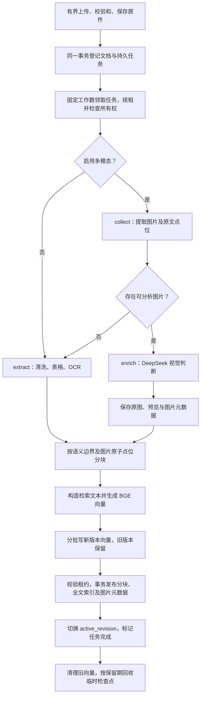
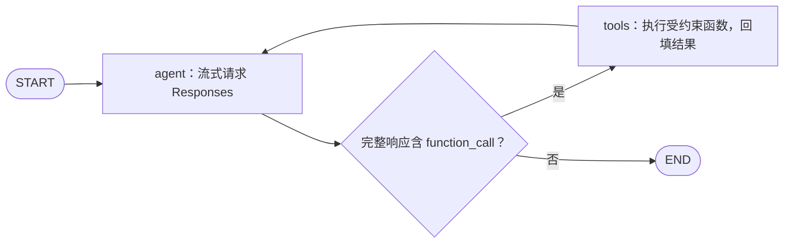
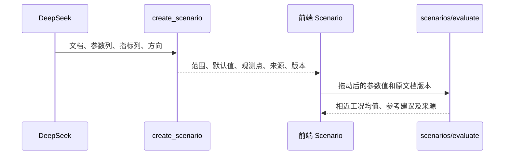
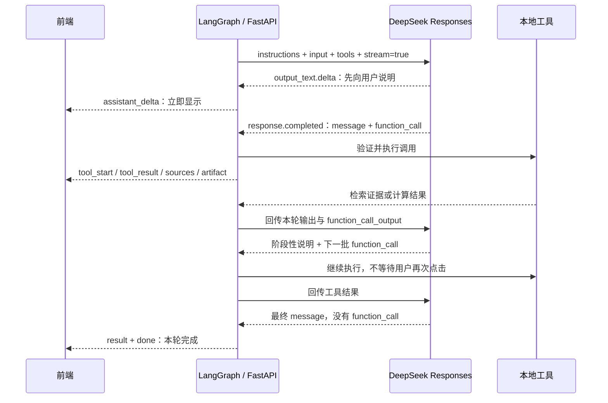

# 关键设计说明

本文解释当前代码如何工作、为什么这样划分职责，以及哪些能力尚未实现。阅读顺序为：前置清洗 → 普通/多模态入库及存储 → LangGraph → 检索、图表与控件工具。操作命令见 [README](../README.md)，多模态接口细节见 [multimodal.md](multimodal.md)。

## 1. 总体职责划分

项目把文件解析、模型决策和数值计算分开。文件解析器负责保留证据及位置，DeepSeek 负责选择工具、理解图片和组织回答，后端函数负责可验证的检索与计算，前端根据结构化结果渲染图表、滑块和附图。

| 模块 | 关键入口 | 职责 |
|---|---|---|
| 接口 | [backend/main.py](../backend/main.py)：`upload`、`lifespan` | 接收原件、原子登记任务、背压、分页、会话/SSE及控件计算接口 |
| 入库调度 | [pipeline.py](../backend/pipeline.py)：`IngestionRunner`；[jobs.py](../backend/jobs.py)：`JobQueue` | 固定工作数、持久队列、租约、检查点、限流与版本发布 |
| 隔离解析 | [parse_worker.py](../backend/parse_worker.py)、[checkpoints.py](../backend/checkpoints.py) | 可终止的解析/OCR子进程、原子JSON及图片检查点 |
| 普通解析 | [backend/ingest.py](../backend/ingest.py)：`extract`、`clean`、`table_blocks`、`split_blocks` | 多格式清洗、OCR、表格结构、普通分块 |
| PDF 版面 | [backend/pdf_layout.py](../backend/pdf_layout.py)：`page_blocks`、`page_text`、`needs_ocr` | 显示坐标下的阅读顺序及 OCR 路由 |
| 多模态 | [backend/multimodal.py](../backend/multimodal.py)：`collect`、`enrich`、`persist_images` | 图片定位、视觉判断、原位替换、原图/预览存储 |
| 图片点位与检索文本 | [backend/media.py](../backend/media.py)：`split_anchored`、`retrieval_text` | 不可拆图片标记、分块归属、图像语义转入文本索引 |
| 元数据 | [backend/store.py](../backend/store.py)：`Store` | SQLite 文档、分块、图片元数据和消息快照 |
| 向量及数值工具 | [backend/retrieval.py](../backend/retrieval.py)：`VectorIndex`、`chart`、`scenario`、`evaluate` | LanceDB、混合检索、图表聚合、历史工况计算 |
| Agent | [backend/agent.py](../backend/agent.py)：`TextileAgent.run` | LangGraph 模型/工具循环、文档范围、来源与产物收集 |
| Responses 与回合记录 | [responses.py](../backend/responses.py)、[turns.py](../backend/turns.py) | 无状态协议、文字增量、调用配对、有序回复及中断保存 |
| 呈现 | [frontend/src/main.jsx](../frontend/src/main.jsx)、[Passage.jsx](../frontend/src/Passage.jsx) | `DataChart`、`Scenario`、原位附图和回答来源 |

**图表和控件的生成都是工具实现。** 模型选择文档、列名和计算方式，图表产物由后端计算，前端不会执行模型生成的代码。文件入库由持久任务及固定数量工作协程完成，可随 API 内嵌启动，也可独立运行，不是 LangGraph 中的节点。并发、恢复和部署说明见第 7 节。

## 2. 数据前置清洗

### 2.1 先验证文件，再提取可追溯内容

上传接口接收原件和可选的 `multimodal` 表单字段，默认 false。它检查扩展名、空文件和大小，以服务端生成的文档 ID 保存原件，而不是直接使用用户文件名构造路径。接口返回 HTTP 202，表示接收并排队，不表示解析已经完成。

默认限制包括单文件 30MB、PDF/多帧图片 200 页或帧、单表 2 万行、单文档 3 万块；Office 文件检查解压体积 200MB，避免小压缩包展开成不可控的数据量。多模态另有图片数量和像素/总大小限制。

普通解析统一输出 `Extraction`，其中主要是 `Block` 列表：

| 字段 | 含义 |
|---|---|
| `text` | 清洗后的原文、OCR 文本或带标记的文本 |
| `locator` | 页码、段落、工作表、物理行号等来源位置 |
| `kind` | `text`、`table`、`ocr`，多模态还会产生 `visual` |
| `fields` | 表格一行的「原始列名 → 单元格值」映射 |
| `images` | 与该块图片点位对应的元数据；普通流程为空 |

统一结构让后续分块和索引不必再区分输入文件是 PDF、Word 还是 CSV，但来源位置、数据类型和单位仍被保留。

### 2.2 文本清洗只做格式归一，不改写事实

`decode` 依次尝试 UTF-8 BOM、GB18030 和编码探测；`clean` 做 Unicode NFKC 归一、移除空字符、合并横向空白和多余空行。例如全角数字可归一成普通数字，但不会用模型「猜一个更合理的克重」或擅自补齐缺失数据。

保留来源原件很重要：NFKC、OCR、模型转写都可能改变文本表现，用户需要能打开原文件核对。前端的「核对原文页」按 PDF 分块的来源页打开原件。

### 2.3 不同格式使用不同解析策略

| 输入 | 清洗/提取方式 | 保留的信息与边界 |
|---|---|---|
| TXT、Markdown | 编码识别、文本归一、识别 Markdown pipe 表格 | 正文及结构化表格；不是执行 Markdown 中的指令 |
| CSV、TSV | 按分隔符读取，首个非空行作为表头 | 保留单位、重复列名的区分、原始物理行号；空行不会导致行号错位 |
| XLSX、XLS | 按工作表提取表格 | XLSX 读取公式缓存值，不运行 Excel 公式；缓存为空时提示重算保存 |
| DOCX、PPTX | 段落/幻灯片、表格，普通模式对内嵌图做 OCR | 普通模式保留识别出的文字，不建立图像资产与文段的绑定 |
| HTML | 去除 script、style、nav 等，再提取正文和表格 | 不执行网页脚本；多模态也不自动下载外链图片 |
| PDF | 恢复阅读顺序、提取表格、按条件做页面或内嵌图 OCR | 保留页码及 OCR 来源；复杂版面仍需人工核对 |
| 独立图片、TIFF 多帧 | 方向修正、颜色转换、尺寸控制、OCR | 普通模式依赖可提取文字；无文字图需开启多模态才能获得视觉描述 |

表格不先拼成一大段自然语言。`table_blocks` 把每个数据行表示为一块，同时保留 `fields`。这使回答可以检索该行，图表也能用原始字段计算，而不必从模型生成的句子重新提取数字。

### 2.4 PDF 为什么需要单独的版面处理

PDF 的文本对象顺序、坐标排序和人看到的阅读顺序并不总是一致。项目曾在旋转课件上直接使用排序文本，结果把句子打散；增加分块或更换生成模型并不能修复这些输入错误。

当前 `page_blocks` 保留文本块、行、span 的层级，先通过 `page.rotation_matrix` 将边界换算到显示方向，再组合同行片段并排序文本块；列表符号与正文一起恢复。它是轻量版面恢复器，不是能理解任意多栏、复杂公式和跨页表格的通用版面模型。

普通 PDF 的 OCR 路由也不再简单使用「少于 40 字」：空文本或明显损坏编码会走 OCR；文字很少但存在覆盖大部分页面的扫描图，也会走 OCR；短数字化标题不会仅因字少而重复识别。有文字层的混合 PDF 还会处理达到尺寸阈值的内嵌图片。

## 3. 普通入库与多模态入库

### 3.1 两条分支与公共发布流程



`IngestionRunner` 默认运行 2 个文档工作协程，积压任务只在 SQLite 中排队。至少有 2 个工作协程时，其中一个保留给不会调用 OCR/视觉的普通文本与表格格式，其余处理全部格式；不会因为视觉服务慢而占住所有工作位置。单文档视觉分析最多并发 2，同时还受跨进程视觉槽位和每分钟请求预算限制。无图片时不创建视觉请求，也不需要仅为该次无图入库提供 API 密钥。

文档处理状态为 `queued → parsing → indexing → ready`，有图时经过 `analyzing`。任务另有 `queued/running/done/failed` 状态及 `available_at`、租约、尝试次数。瞬时故障退避重试，永久错误或超过次数后进入 `error`。首次导入失败不能检索；已有已发布版本时，重新解析期间及失败后仍可检索旧版本。重启依赖持久任务和租约接管，不为每份积压文档创建内存任务；当前使用同机 SQLite 队列，没有外部消息代理。

### 3.2 普通模式到底入库什么

普通模式调用 `extract`：正文、表格行、OCR 文本进入分块；原 PDF/Word/图片仍作为原文件保留。扫描件的 OCR 文本不会因为看起来像表格就自动变成可信 `fields`。

例如 CSV 的一行可以产生：

```json
{
  "text": "机台: 定型A; 不良率_pct: 1.2",
  "locator": "工作表 1 · 行 2",
  "kind": "table",
  "fields": {"机台": "定型A", "不良率_pct": "1.2"},
  "image_ids": [],
  "images": []
}
```

系统再补充分块 ID、文档 ID、顺序号和版本。`fields` 中的字符串保留原始单位口径；是否能当数值使用，由计算工具的 `number` 校验，而不是在清洗时强制猜测转换。

### 3.3 多模态先定位，再让模型判断

`collect` 生成带图片点位的文本流和临时 `Candidate`，此时还不调用 LLM，也不向外部 URL 抓图。

| 格式 | 图片位置如何取得 |
|---|---|
| PDF | 栅格图的出现边界换算到显示坐标；可检测的矢量图区域渲染为局部图，并记录源区域 |
| DOCX | 在段落/运行与表格单元格 XML 中寻找嵌入图，保留文字—图片—文字顺序；普通页眉页脚单独定位 |
| PPTX | 图片形状按幻灯片位置进入该页文本流 |
| XLSX | 根据图片锚定行，把图片附到对应数据行；没有对应数据行时形成单独定位块 |
| HTML、Markdown | 对内嵌 base64 图在原位置插入标记；外链/未提供的相对路径图只提示缺失，不抓取 |
| 独立图片 | 每幅/帧作为独立图片候选 |

发现实际图像资产却无法定位时，不把它当作无图文件静默处理。对于未支持的复杂组合形状或旧格式，应转换或人工复核。

`enrich` 给 DeepSeek 提供图片以及**图片点位附近**的文字：本块点位前后各约 580 字，前块末尾和后块开头各约 280 字，避免长文章的开头挤掉真正相邻的说明。邻文和图片中的指令均按不可信资料处理。

视觉输出用 `VisualDecision` 校验，包含 `decision`、`category`、`description`、`transcription`、`has_readable_text`、`reason` 和 `confidence`。实际保留规则为：

- 模型选择 `retain` 时保留；可以完整文字化时，用标注为模型生成的描述/转写替换原点位。
- `fabric`、`photo` 类别保守保留；无文字独立图片也必须保留，不受模型偶然选择 `text` 的影响。
- 模型自报置信度低于 0.75 时保留，并给出复核提示；这个分数不是经校准的准确率。
- 视觉请求失败或结构不合法时入库失败，不用空 OCR 或不完整的图片列表伪装成成功。

### 3.4 图片点位与分块的关系

原位保留标记格式为 `[[IMG:0123456789abcdef]]`。这是服务端生成的示意 ID，不是模型提供的文件路径，也不是为 DeepSeek/BGE 扩充 tokenizer。

`split_anchored` 先把普通文字拆成字符单元，把每个有效图片标记整体作为一个逻辑单元，再执行窗口切分与重叠。因此标记不能从中间断开。重叠区会调整起点，使同一个图片出现位置拥有单一分块归属，而不是复制给后续无关窗口。不同位置出现的同一底图可以拥有不同图片 ID。

普通文字默认约 420 字符、60 字符重叠，优先段落、句子、换行和空白边界；英文重叠区不从半个单词开始。表格按行保留；带单张图的独立视觉描述也作为完整语义块保存，二者有 6000 字上限，而不机械套用 420 字符。

假设原文为：

```text
素材比较：前文 [[IMG:aaaaaaaaaaaaaaaa]] 两图之间 [[IMG:bbbbbbbbbbbbbbbb]] 后文
另一段不含图的说明
```

分块结果通过 `image_ids` 和 `images` 绑定对应图。一段可以绑定两张图，另一段仍然没有图。独立无文字图片则形成 `kind=visual` 的描述段，描述与原图不会被拆开。

### 3.5 两种模式分别保存哪些数据

| 数据 | 普通入库 | 多模态有图入库 | 保存位置 |
|---|---|---|---|
| 原始上传文件 | 保留 | 保留 | `data/uploads/<doc_id><suffix>` |
| 文档状态、版本、大小、页数、警告 | 保存 | 保存；新增开关、实际分析图数、附图数 | SQLite `documents` |
| 文本分块、顺序、位置、类型、结构化字段 | 正文/表格/OCR | 原文 + 模型转写或视觉描述 + 保留图片点位 | SQLite `chunks` |
| 图片归属 | 空 | `image_ids` 绑定具体分块 | SQLite `chunks.image_ids` |
| 图片描述及判断依据 | 无独立记录 | 描述、转写、保留决定、类别、模型、位置、尺寸、区域等 | SQLite `images.metadata` |
| 图像文件 | 只保留原上传文件本身，不另挂分块图 | 提取原图；PDF 需要时另存显示预览 | `data/assets/<doc_id>/` |
| 向量 | 普通检索文本的 512 维 BGE 向量 | 原文加视觉语义的 512 维 BGE **文本**向量 | LanceDB `chunks` 表 |
| 对话及回答来源 | 发生对话时才保存 | 发生对话时保存带图来源及所用图片 ID | SQLite `chats`、`messages` |
| 任务、租约、发布版本、上传重试标识 | 保存 | 保存 | SQLite `ingest_jobs`、`mutations`、`resource_slots`、`upload_keys`；`documents.active_revision` |
| 全文倒排索引 | 分词后的原文 | 分词后的原文及图片描述/转写 | SQLite FTS5 `chunk_fts`，与分块同事务发布 |
| 可丢弃计算缓存 | 嵌入内容缓存 | 嵌入缓存及视觉结果缓存 | `data/cache.sqlite3`，不是权威数据 |
| 恢复检查点 | 解析结果JSON | 解析结果、候选图片及逐图成功结果 | `data/jobs/<job_id>/`，按保留期回收 |

LanceDB 表只保存 `id`、`document_id`、`revision`、`vector`，不重复保存正文或图片二进制。正文和关联关系以 SQLite 为准；文件系统保存大对象。`Store.chunks` 将图片元数据装配回分块，使检索层拿到完整图文对象。

可文字化的图片也保留资产以供追溯，但不会作为该分块的附图返回。栅格原图保留解码后的原始像素，PNG 封装/EXIF 可能与上传字节不同；PDF 预览不覆盖原始栅格图。矢量图没有独立栅格原件时，保存的是带源区域记录的 PDF 区域渲染。

### 3.6 发布、编辑与历史版本

SQLite 是元数据权威，LanceDB 是派生索引。`revision` 表示当前处理目标，`active_revision` 表示已发布版本，两者在重新处理时可以不同。新向量按目标版本分批暂存，全部成功并校验数量后，在一个 SQLite 事务中验证任务所有权、替换分块/全文索引、插入图片记录、切换有效版本并完成任务。旧向量随后清理。检索用当前分块和有效版本过滤暂存、陈旧及已删除记录。

这不是跨文件系统、SQLite、LanceDB 的全局事务。发布前失败会保留旧数据和检查点；首次导入仍不可见。发布后旧向量清理失败属于维护欠账，不把已经成功发布的文档改成失败。租约过期的工作进程无权修改文档阶段或发布结果；进程间文件锁避免同一任务/文档的原生写入互相覆盖。

编辑先通过 SQLite 比较版本并领取文档修改租约，阻止并发编辑、删除和重新排队。随后暂存新版本向量并事务发布，提升所有分块及文档版本；失败仍保留旧版。未变内容复用嵌入缓存，当前仍按文档写新版本向量。表格编辑同步更新 `fields`；带图编辑必须保留原标记集合，`[附图]` 行不当作新表格列。

重新解析从原件重建，确认后覆盖手工校对并产生新图 ID。旧图资产保留，以便历史来源仍可查看。删除先事务移除可检索元数据并登记 `garbage`，再删除原件、当前/历史图像和向量；物理删除失败由维护任务重试，已经删除的内容不会再次进入检索。历史回答文字快照保留，图片接口返回已移除。

## 4. LangGraph 状态图

### 4.1 图中只有模型节点和工具节点



代码中的 `StateGraph(AgentState)` 注册两个节点 `agent` 和 `tools`，通过 `pending` 是否为空决定继续或结束。**文字已经展示、单条消息结束、供应商一次 response 完成，都不单独代表整轮结束**；完整响应中仍有 `function_call` 就进入工具节点并再次请求模型。五个工具不是五个固定图节点，模型可以在一轮选择多个工具或拿到证据后改写查询。

实际路径可以是「先回复说明 → 列文档/检索 → 阶段性答复 → 继续读原文/计算 → 显示图表和滑块 → 最终答复」。只有不再包含工具调用的完整响应才结束本轮。阶段性回复来自模型公开输出，不展示内部推理；当前没有独立的 planner、grader、反思模型或多 Agent 图。

### 4.2 状态与一次请求的局部结果

| 字段 | 当前作用 |
|---|---|
| `items` | Responses 输入项：近期公开对话、本轮输出、配对工具结果及必要图片消息 |
| `rounds` | 已进行的模型轮数，用来控制工具调用预算 |
| `pending` | 本次完整响应的 `function_call` 列表 |

系统规则单独通过 `instructions` 传入，每次请求重发。公开结果由请求内的 `TurnState` 投影收集，包含有序 `parts`、兼容正文 `content`、产物、来源和工具记录；这些结果不是通过 LangGraph reducer 累加。API 使用相同事件更新 `ProgressWriter`，约每 350 毫秒合并写入一条 assistant 消息，最终状态覆盖同一行，不为每个 token 或段落新增数据库行。

当前图每次请求编译和运行，没有持久化 LangGraph checkpoint。跨轮上下文读取最近 16 条消息，单条公开正文截取最多 8000 字符；未完成的旧回复加上背景提示，空的当前 assistant 占位消息不送入模型。历史图片需要本轮重新取得，历史来源也不自动视作当前有效证据。保存公开进度不等于可以从上次图节点自动恢复运行。

### 4.3 循环预算、工具失败和流式反馈

- 默认前 7 次模型请求可选择工具，最后一次设置 `tools=[]`、`tool_choice=none`，要求基于已有证据总结；总次数由 `CHAT_MAX_ROUNDS` 控制，默认 8。
- 每步最多执行 8 个工具调用；超出的调用也会收到对应错误响应，避免留下没有配对结果的 tool call。
- 参数错误、列名错误或证据不足作为工具错误回填，让模型有机会修正参数；不会转为执行任意代码。
- 图递归上限按模型次数计算为 `2 × CHAT_MAX_ROUNDS + 2`；整轮超时由 `CHAT_TIMEOUT_SECONDS` 控制，默认 300 秒。同一聊天有进程内锁，直到整轮完成才释放；单次 SDK 请求另有超时和重试。
- 模型文字通过 `assistant_delta` 实时送出；`assistant_message` 校正完整段落及阶段，`tool_start/tool_result`、`sources`、`artifact` 在执行时送出，`result` 提供完整校准快照，`done` 才结束应用 SSE。空闲时发保活。
- 供应商流出现 `response.incomplete/failed` 或缺少完整终止事件时，保留已接收文字并报错，不执行半截工具参数。收到 `response.completed` 后立即关闭该次供应商流，不等待额外 EOF。
- 用户停止、连接中断、超时或后续错误都保留已有公开内容和产物。停止/断连记录为 `interrupted`，超时/错误记录为 `failed`；清理过程屏蔽 Starlette 重复取消，保证尽可能完成末次写入并释放锁。硬崩溃可能保留 `in_progress` 的最近快照，界面按未完成回复展示，不伪装成最终答案。

### 4.4 来源与图片进入模型的方式

工具返回的分块按 ID 收集为来源快照。每段公开正文中的 `[C:ID]` 检查是否已在本轮取得该来源，未知 ID 替换为未验证提示；流式传输暂存不完整引用，避免先显示伪造链接。该检查只验证引用存在，不能证明结论被原文语义支持。

带图分块的图片元数据先进入工具 JSON，后端从已检索、已检查范围的本机资产读取图片，以 `user` 消息的 `input_image` 加入后续 Responses 请求。每次 `run` 最多发送 6 张不同原图，`vision_images_used` 记录 ID；所有关联图片仍随来源返回。不会读取模型编造的 URL 或任意路径，base64 图片与推理内容不进入消息快照。

## 5. 关键工具设计

### 5.1 工具的接口与分工

| 工具 | 主要参数 | 结果与用途 |
|---|---|---|
| `list_documents` | 可选 `query`、`offset` | 按名称筛选、每次最多 50 份可检索文档，返回下一页位置；列名在入库时汇总，不加载全部分块 |
| `search_knowledge` | `query`、可选 `document_id` | 默认最多 8 个带位置、版本、图像的混合检索分块；查询截取最多 1000 字符 |
| `read_document` | `document_id`、可选 `offset` | 按原顺序每次读 30 块，返回总数及下一页偏移，补足 top-k 没覆盖的上下文 |
| `create_chart` | `document_id`、`group_by`、`metric`，可选聚合/类型 | 在完整结构化表格上统计，返回图表产物而不是图片 URL 或可执行代码 |
| `create_scenario` | `document_id`、`parameter`、`metric`，可选 `direction` | 根据有效历史数值生成范围、步长、默认值、观测点及来源，供前端建立滑块 |

JSON 工具 schema 约束参数形状，执行函数还校验文档状态、检索范围、列名及允许的操作。工具 schema 不是完整的事实验证器，后端业务校验仍然必要。

### 5.2 检索器：文本语义与精确关键词融合

`retrieval_text` 对普通块使用正文；对带图块额外加入模型视觉描述和可读图片文字，同时移除不透明图片 ID 标记。这样能用「蓝灰人字纹」找到没有 OCR 文字的布样图，而不是试图用图片 ID 做语义匹配。

检索过程：

1. 入库时把同一份检索文本用 jieba 分词、小写归一，持久保存到 SQLite FTS5；发布时与正文保持同事务。
2. 查询词先分词、逐词转义，使用 FTS5 的 BM25 排名取最多 30 个符合文档范围、有效版本的候选。无需在每次请求中读取全库或重建 BM25。
3. 使用 FastEmbed 的 `query_embed` 生成 BGE 查询向量，在 LanceDB 取有界候选，指定文档时将范围过滤下推。默认 top-8 查询向量侧最多取 64 个候选。
4. 按候选 ID 批量读取当前 SQLite 分块及其实际关联图片，过滤版本不匹配的向量，再用 RRF 融合排名，返回最多 8 个结果。排名从 0 起，单路贡献为 `1 / (60 + rank + 1)`。

融合的是名次，不直接相加 BM25 和向量距离，因此不用假设两路分数同尺度。返回的融合分数及 `_distance` 都不是「回答正确率」，也没有另外部署神经 reranker。

存量分块的全文索引通过后台每批 256 块迁移，完成前向量仍可用，全文召回可能不完整。向量表达到 1 万行后，维护任务创建文档标量索引和 cosine IVF_FLAT 索引，并定期优化碎片。索引训练使用独立表句柄，不占在线查询的进程内锁，但会竞争 CPU/磁盘，并暂时占用向量写入锁。暂存/孤立向量仍可能挤占有限候选，因此该方案不保证任意过滤分布下的满召回；高更新量和更大语料需要进一步做索引及召回评估。

420 是字符分块预算，不是嵌入模型 token 预算；长表格行和完整视觉描述可能超过嵌入模型上下文。SQLite 和 BM25 仍保留完整内容，但向量模型的有效输入范围需要用业务样本评估。

### 5.3 图表：从完整表格计算，不从检索片段抽样

`create_chart` 在 [retrieval.py](../backend/retrieval.py) 调用 `chart`，只读取 `kind=table` 且有 `fields` 的行。即使检索只找出 8 条，图表统计也会读取选中文档的完整结构化表格。

模型必须给出与原表完全一致的列名及单位。`number` 接受有限数值、带千分位的数值字符串和百分数字符串；日期、范围、不等式及 `3 kg` 这类混合内容不会被猜成数值。百分数 `2.1%` 对应数值 2.1，单位由原列名解释，不自动换成比例 0.021。

支持 `mean`、`sum`、`min`、`max`、`count`，其中 `count` 统计通过数值校验的记录，不是所有原始行。聚合默认 `mean`，图形默认 `bar`，也支持 `line`；缺失/非数值行会排除并报告数量，超过 100 个分组会拒绝，避免渲染无意义的大图。

产物包含 `type=chart`、`data`、分组/指标/聚合口径、有效来源 ID、原文档 ID 和版本。前端 `DataChart` 只负责 SVG 绘制、标签和数据表，不重算统计值。

例如演示 MES 表按机台对不良率做算术平均，A=1.25%、B=2.10%、C=0.85%。这不能称为按产量加权的总体不良率：要算总体口径，需要正确分子、分母和相应实现，不能仅改变模型措辞。

### 5.4 控件：生成配置与拖动计算是两个阶段

`create_scenario` 是 Agent 工具，`POST /api/scenarios/evaluate` 是交互计算接口。前者创建控件，后者处理拖动；每次拖动不会再走一轮 LLM。



生成时至少需要 3 条有效参数/指标对、2 个不同参数值。范围取历史参数最小/最大值，步长约为范围的 1/100；默认值是使目标指标最小或最大的历史单条观测对应参数，方向默认 `min`。返回的观测点用于散点展示，并作为来源证据。

拖动后前端等待 200ms 再请求，并取消过时请求。后端先检查当前文档版本与输入范围：有精确相同参数值时，取这些观测的指标均值；没有精确值时，取参数距离最近的 3 条观测的简单平均。建议文本由后端模板生成，同时提供历史单条最优观测，保证反馈可复算。

例如演示数据在 150°C 的精确观测均值为缩水率 5.10%，180°C 为 2.45%。这不是插值、回归、因果预测或多变量优化；当前只按所选参数计算距离，没有控制车速、布种、含湿率等混杂因素。

文档新版本发布后，历史图表仍是当时的快照，旧滑块计算请求因有效版本不同返回 409。重新解析尚未发布时，旧滑块仍使用旧数据。

## 6. 设计验证与后续改进位置

| 测试文件 | 关注点 |
|---|---|
| [test_ingestion.py](../tests/test_ingestion.py) | 编码、表格、OCR、旋转 PDF 完整列表和英文边界 |
| [test_multimodal.py](../tests/test_multimodal.py) | 原子点位、多图归属、长独立描述、局部邻文和各格式定位 |
| [test_api.py](../tests/test_api.py) | 上传、版本、编辑、重新解析、SSE 和会话 |
| [test_multimodal_api.py](../tests/test_multimodal_api.py) | 默认关闭/无图回退、视觉故障、图像接口、带图编辑及删除生命周期 |
| [test_retrieval.py](../tests/test_retrieval.py) | 真实 LanceDB 读写、范围/版本、图表准确值及工况计算 |
| [test_agent.py](../tests/test_agent.py) | LangGraph 工具循环、产物和引用 ID 校验 |
| [test_responses.py](../tests/test_responses.py) | 先回复再工具、无状态回传、调用配对、中断流/停止/超时保存及视觉请求格式 |
| [test_ingestion_jobs.py](../tests/test_ingestion_jobs.py) | 10 万积压任务的固定工作数、并发领取、租约接管、资源预算、超时、恢复、缓存和旧版保留 |
| [test_ingestion_api.py](../tests/test_ingestion_api.py) | 上传幂等、背压、分页、失败编辑保留旧版 |

真实验收另由 [acceptance.py](../scripts/acceptance.py) 和 [acceptance_multimodal.py](../scripts/acceptance_multimodal.py) 调用实际模型与服务，区别于为了稳定和节约费用而使用替身的模型单测。API 验收不替代前端视觉验收，也不意味着所有自然语言结论已经事实核验。

当前已检查空内容、图片点位/归属完整性、嵌入维度/有限数值和向量数量，但尚未自动验证语句保真、表格数值正确性或引用语义支持。还需建立业务质量基准、召回评估、生产鉴权和部署监控。因此「任务完成、索引就绪、引用 ID 存在」都不能单独代表数据和答案质量合格。

## 7. 大积压与并发入库的实现

### 7.1 目标与适用范围

本次改造解决单个慢文件阻塞整个队列、进程重启后重复从头处理、大量任务消耗内存、视觉限流和重新解析导致旧知识不可用的问题。部署范围是**共享本地磁盘的一台机器**，保留 SQLite 和 LanceDB，没有引入 Redis、分布式队列或多机数据库。

10 万条任务、10 万个分块和 10 万份复杂文档是不同指标。这里验证了 10 万积压任务的调度有界性，以及小规模真实并发导入；没有据此宣称已完成 10 万份 PDF、千万分块或多租户生产验收。

### 7.2 接收端的背压与上传幂等

`upload` 默认同时允许 4 个请求写入原件；超额返回 429。队列默认最多容纳 1 万条 queued/running 任务，达到上限返回 503 和 `Retry-After`，已有任务继续处理。接收前检查磁盘余量，空间不足返回 507。上传大小限制仍为 30MB。

接口在写完、刷新原件并计算 SHA-256 后，在同一 SQLite 事务中登记文档及任务，因此不会出现「返回已接收，却只创建了内存任务」的状态。`Idempotency-Key` 用于网络重试：同一标识、相同内容和模式返回原文档，不重复排队；相同标识配不同内容或模式返回 409。没有这个请求头时，相同文件仍允许作为不同来源分别导入，不自动合并业务身份。

进程恰好在文件落盘后、数据库登记前崩溃仍可能遗留无主原件。文件系统和数据库不属于同一事务，部署时应监控磁盘并安排无主文件审计；不能将本接口描述为跨存储的原子上传。

前端每批最多 3 个并行上传，请求带稳定重试标识；遇到 429/503 根据 `Retry-After` 有限重试。文档列表每页 30 份、分块每页 50 块，搜索在服务端执行。兼容的 `/api/documents` 默认最多返回 100 份，可用 limit/offset 翻页，不再保证一次返回全库。

### 7.3 持久队列、租约与失败隔离

[JobQueue](../backend/jobs.py) 用 `BEGIN IMMEDIATE` 串行完成极短的领取事务。同一条任务只有一个有效 owner，默认租约 90 秒，每隔租期的 1/3 续租。修改阶段和发布结果都检查 owner、running 状态及租约未到期；过期任务可以被其他工作进程接管，旧执行者不能覆盖结果。

这是**至少一次执行 + 幂等恢复**，不是严格一次执行。进程若在外部模型返回后、结果持久化前崩溃，后续仍可能重复调用并计费。重试通常从已有检查点恢复，而不是承诺外部 API 严格只调用一次。

领取任务或修改租约的后台线程可能晚于取消信号完成。`acquire_durable` 会等待领取结果并归还迟到租约，避免服务退出后留下无人执行的 running 任务；写线程也必须结束后才释放锁。

默认 2 个文档工作协程加 1 个维护协程，不随积压数量增加。至少 2 个工作协程时，保留其中一个给普通 TXT/MD/CSV/TSV/XLSX/XLS/HTML 格式，防止慢 OCR/视觉占满全部文档位置；其余工作协程处理全部格式。这是职责分区的固定工作数，不是每个阶段都已拆成独立持久队列。只有一个工作协程时没有这项隔离。

连接故障、视觉 429/5xx、超时和临时存储故障采用指数退避加抖动，默认最多 4 次尝试；视觉服务的数字秒数 `Retry-After` 会被考虑，最多等待 600 秒。错误格式、无密钥、不可解析文件等永久错误直接标记失败。人工重试重置次数并复用可用检查点。

### 7.4 解析进程和模型资源

解析及 OCR 在独立 Python 子进程中执行，父进程默认 300 秒超时后终止并回收它；取消任务时也会终止子进程。子进程还监控父进程存活和自身处理期限，减少主服务异常退出留下的孤儿解析进程。解析槽位由 SQLite 租约协调，数量与配置的工作数一致。现有单文件页数、行数、图片数和像素限制仍然有效。

视觉分析同时受全机共享的槽位和滚动一分钟请求预算约束，默认同时 2 个请求、每分钟 30 个请求。SDK 对视觉调用关闭内部重试，让一次预算许可对应一次请求尝试；每次分析默认 100 秒超时。该预算只覆盖入库视觉，不覆盖聊天请求，也不是供应商账户的 token 配额或费用硬上限。

嵌入模型按进程长驻，每批默认最多 32 条；查询在批次之间优先于入库。它不能抢占已经开始的推理，也不能保证原生模型库永不阻塞。默认仍是 CPU ONNX；8GB 显存环境应避免多个进程分别加载 GPU 模型，不能靠增加工作数解决显存不足。

SQLite 和文件锁协调同机数据所有权，但不同进程各自持有模型。默认内嵌模式最容易使用；要隔离 Web 生命周期与入库，可关闭 Web 内嵌工作协程，再运行一个独立 worker：

```powershell
# API 终端
$env:INGESTION_ENABLED = 'false'
uv run --frozen uvicorn backend.main:app --host 127.0.0.1 --port 8000 --limit-concurrency 64
```

```powershell
# 独立终端，worker 入口会显式启用入库
uv run --frozen python -m backend.worker
```

两者必须指向同一个本地 `TEXTILE_DATA_DIR`。8GB 显存下建议保持一个入库服务，按 CPU/内存实测调整工作数；不要把此方案用于多台机器共享网络盘，也不要直接增加多个 GPU worker。API 多进程下聊天锁仍是进程内锁，聊天并发控制需要另行改造。

### 7.5 检查点与内容缓存

解析结果和候选图保存在 `data/jobs/<job_id>/`，JSON和图片通过临时文件、刷新及原子替换发布，不使用 pickle。检查点指纹包含原文件校验和、解析相关代码、依赖锁文件、Python 主次版本、多模态模式和图片数量配置；不匹配时重新解析。当前恢复粒度是整份文档的解析结果，没有做到 PDF 每页 OCR 检查点。

每张成功分析的图立即保存结果。视觉缓存键同时包含图像像素输入、模型/接口、提示词、局部邻文和位置，避免同图不同说明时错误复用。失败项重试时复用已经成功的图片结果。

嵌入缓存按检索文本、模型名、执行提供者、FastEmbed 版本及 `EMBEDDING_CACHE_VERSION` 建键。相同文本不重复推理，变更文本才生成新向量；但文档重建仍会写完整目标版本，不是行级向量增量合并。如果替换同名模型权重，应提升缓存版本并重新索引，当前不会自动校验整套模型权重哈希。

共享缓存逻辑负载默认 512MB，维护任务回收旧条目；上限是维护时检查的负载预算，数据库文件和维护间隔内的峰值可能更大。成功任务检查点默认保留 24 小时，失败任务保留 7 天供重试；到期后可以从原件重建。失败检查点回收时，仅删除未登记为历史/当前图片的临时资产。所有已发布历史图片继续按原有保留策略存储，仍需容量规划。

### 7.6 写入、查询与维护互不长期占锁

向量写入每批默认最多 256 条，计算嵌入时不持有向量写锁。不同任务允许交错处理，在实际写入时用进程内锁及同机文件锁协调；查询不必等待整份文档的嵌入完成。线程写操作被取消时，会先等该次原生写入结束，再释放文档锁，避免「线程仍在写，但任务已经被别人接管」。

新版本发布前检查分块非空、图片标记一一归属、向量 512 维、向量值有限、实际向量行数与分块数一致。发布事务包含全文索引和有效版本切换。图表/控件同时携带计算时的来源快照与版本，避免计算后恰逢发布导致来源混用新旧数据。

维护任务分批回填旧全文索引、恢复过期修改租约、清理删除任务、回收临时检查点和缓存，并在向量数量达到阈值后训练/维护索引。维护默认每分钟轮询，向量维护每个进程最多每 5 分钟执行一次；训练和优化可能占用写锁、CPU及磁盘，吞吐敏感时仍应安排维护窗口。

### 7.7 可调整参数与可观测入口

| 环境变量 | 默认值 | 用途 |
|---|---|---|
| `INGESTION_ENABLED` | true | Web 是否内嵌运行入库工作协程 |
| `INGESTION_WORKERS` | 2 | 固定工作数，最大 8，通常先保持默认 |
| `INGESTION_QUEUE_LIMIT` | 10000 | 排队及运行中的任务容量 |
| `INGESTION_MAX_ATTEMPTS` | 4 | 自动尝试次数上限 |
| `INGESTION_LEASE_SECONDS` | 90 | 任务/资源租约期限 |
| `INGESTION_POLL_SECONDS` | 0.25 | 无任务时轮询间隔 |
| `PARSE_TIMEOUT_SECONDS` | 300 | 解析/OCR 子进程超时 |
| `VISION_TIMEOUT_SECONDS` | 100 | 单张视觉调用超时 |
| `VISION_CONCURRENCY` | 2 | 同机视觉在途请求数 |
| `VISION_REQUESTS_PER_MINUTE` | 30 | 入库视觉每分钟请求预算 |
| `EMBEDDING_BATCH_SIZE` | 32 | 单次嵌入批次 |
| `VECTOR_WRITE_BATCH_SIZE` | 256 | 单次向量写入批次 |
| `UPLOAD_CONCURRENCY` | 4 | 单 API 进程同时落盘的上传数 |
| `MINIMUM_FREE_DISK_MB` | 512 | 上传时保留的磁盘余量，另预留最大文件大小 |
| `CACHE_MAX_MB` | 512 | 共享内容缓存逻辑预算 |
| `CHECKPOINT_RETENTION_HOURS` | 24 | 完成任务的临时检查点保留期 |
| `FAILED_CHECKPOINT_RETENTION_HOURS` | 168 | 失败检查点保留期 |
| `EMBEDDING_CACHE_DIR` | 空 | 可选模型权重目录，留空使用 data/models |
| `EMBEDDING_CACHE_VERSION` | 1 | 同名权重替换时主动使嵌入缓存失效 |

同机多个进程必须使用一致的全局资源配置。`GET /api/health` 提供 queued/running/done/failed 数量及数据库聚合统计；`GET /api/documents/{id}/job` 提供阶段、尝试次数、下次可执行时间和错误，不返回租约 owner。当前不是完整的 Prometheus 指标或告警系统。

### 7.8 验证结果与未覆盖范围

并发入库改造阶段自动测试 **94 项通过**，前端构建通过，包含真实 LanceDB 标量/向量索引创建与查询。现有工作台的 15 份文档、81 个分块迁移后，全文索引数量一致、有效版本一致、图片关联无缺失；升级前已备份元数据。后续 Responses 改造验证见第 8 节。

2026-11-02 的自动测试覆盖 10 万条合成积压任务：只有 2 个工作协程和 1 个维护协程，2 条领取后剩余 99998 条留在 SQLite；退出后释放租约，任务继续可领取。这个测试不包含 10 万份文件解析或 10 万份模型推理。

通过 [benchmark_ingestion.py](../scripts/benchmark_ingestion.py) 对独立 8101 端口服务做真实 HTTP 导入：40 份合成 CSV、每份 32 行、12 路上传并发，使用真实解析子进程、BGE 和 LanceDB，没有调用 DeepSeek。结果为 40/40 就绪，耗时 21.8 秒，上传确认 P95 78 毫秒，177 次健康探测的 P95 32 毫秒、最大约 93 毫秒、错误 0；12 次上传触发背压并成功重试，测试原件全部清理。它是本机的小样本结果，不是通用性能承诺。

并发改造阶段的 Edge 视觉验收被本地站点权限策略拒绝，独立验收服务重启也被自动审批拒绝，详见[当时的验收记录](../artifacts/并发入库验收记录.md)。后续已通过独立 SDK/Agent 测试完成真实 Responses 多模态、图表和控件验证，仍不等同于浏览器视觉验收，见第 8 节。

```powershell
# 会向指定服务创建明确标记的模拟文档，成功后删除自己的测试文档
uv run --frozen python scripts/benchmark_ingestion.py --url http://127.0.0.1:8000 --documents 40 --concurrency 12
```

SQLite 仍只有单个写入者；模型推理、磁盘空间、OCR 质量及供应商配额仍有上限。跨机高并发、多租户、千万分块和长期高更新量需要继续评估 PostgreSQL、对象存储、外部队列、索引维护及容灾。对外部署还需要网关上传超时/体积限制、鉴权、限流、监控和备份。当前实现提高单机抗阻塞与恢复能力，不能替代这些生产部署保障。

## 8. Responses API 与回复后继续执行工具

### 8.1 DeepSeek 的兼容范围决定了接续方式

实现依据 [DeepSeek Responses 使用指南](https://api-docs.deepseek.com/guides/responses_api/) 和 [接口参考](https://api-docs.deepseek.com/api/create-response/)。后端仍使用 OpenAI Python SDK 作为协议客户端，但模型、密钥和地址均属于 DeepSeek，请求改为 `client.responses.create`，地址保持 `https://api.deepseek.com`。

DeepSeek 的 Responses 是无状态接口，不支持 `previous_response_id`、`conversation` 或服务端存储来接续；也不会替客户端执行本项目的 RAG、图表和控件函数。因此每次模型请求都包含系统规则、近期公开历史及本轮已有输入输出，工具由本机后端执行。

| 内容 | 实际发送方式 |
|---|---|
| 系统约束 | 每次请求的 `instructions` |
| 对话 | `input` 中的 `message` 项 |
| 函数定义 | `tools` 内平铺 `name/description/parameters`，没有 Chat Completions 的 `function` 包装 |
| 模型工具请求 | `function_call`，包含唯一的 `call_id`、函数名和 JSON 参数 |
| 后端工具结果 | `function_call_output`，使用同一 `call_id` 配对，再发起下一次 Responses 请求 |
| 图片 | `user` 消息中的 `input_image`，图像由后端编码为 data URL |
| 图片入库结构化输出 | `text.format={type:json_object}`，再由 `VisualDecision` 校验 |
| 推理设置 | `reasoning.effort=none`；供应商即使返回推理事件，也不作为公开文本展示或持久化 |

本项目不依赖 DeepSeek 忽略的 `max_tool_calls` 来限制执行，使用自己的轮次、单步数量和整体超时控制。每个已接收的工具调用都必须回填结果；单步超过 8 个时，超出项回填预算错误，避免破坏下一次请求的调用配对。重复/空 `call_id` 或未完成响应不会被执行。

### 8.2 消息结束、响应结束与任务结束是三个边界



模型的公开文字增量立即显示。`response.completed` 只表示供应商本次请求完成；如果其中有工具调用，模型文字标记为阶段性 `commentary`，继续走工具循环。无工具调用时，最后一段文字标记为 `final`，结束本轮。这个 phase 是应用根据完整响应推导的字段，不假定 DeepSeek 实现了 ChatGPT 内部的消息阶段协议。

这里的“回复后继续”指同一任务的阶段性回复可以出现在工具之前或之间。完整最终答复结束后，再执行新任务仍需要新的用户请求。提示词要求需要工具时实际发出调用，避免只承诺“接下来查询”就结束；没有额外定时任务、隐藏的持续模型循环或强制每条回复都调用工具。

### 8.3 一条 assistant 记录包含有序内容

一轮对话只增加一条 user 和一条 assistant 数据库记录。assistant 的 `parts` 按事件顺序保存：

```json
{
  "status": "completed",
  "api": "responses",
  "content": "我先核对资料。\n\n接着生成图表。\n\n最终结论。",
  "parts": [
    {"type": "text", "id": "r1:message-1", "text": "我先核对资料。", "phase": "commentary", "status": "completed"},
    {"type": "tool", "id": "call-1", "name": "search_knowledge", "status": "completed", "summary": "已返回证据"},
    {"type": "text", "id": "r2:message-2", "text": "接着生成图表。", "phase": "commentary", "status": "completed"},
    {"type": "artifact", "id": "part-chart-1", "artifact_id": "chart-1"},
    {"type": "text", "id": "r3:message-3", "text": "最终结论。", "phase": "final", "status": "completed"}
  ],
  "artifacts": [{"id": "chart-1", "type": "chart"}]
}
```

示例省略工具参数、来源和完整产物字段；真实图表仍关联自己的生成工具调用。`content` 由所有公开文字段拼接，兼容旧界面和历史上下文；图表数据放在 `artifacts`，时间线只存其 ID，减少重复保存。`sources` 和 `trace` 继续兼容原结构。

前端 [chatState.js](../frontend/src/chatState.js) 按 part/call/artifact ID 更新同一个回复，不把最终 `result` 再追加成重复消息；[TurnContent.jsx](../frontend/src/TurnContent.jsx) 按时间线呈现文字和产物。正文仅在工具运行时显示细横线和一行工具名称，结束或后续文字出现时隐藏；被隐藏工具隔开的文字合并到同一个 Markdown 流，不留卡片或空白占位。完整调用记录仍保存在顶部总览和数据库时间线。图表/滑块一生成就显示，不必等最终总结。历史消息没有 `parts` 时继续按旧格式显示，不伪造原本未保存的中间过程。

### 8.4 流式保存与停止语义

上传队列的恢复机制保持不变；聊天使用独立的 `ProgressWriter` 合并文字增量。开始生成时先事务保存 user 和 assistant 占位行，再发送 `turn_start`；生成中定期保存公开快照，完成时等待旧写入结束并覆盖为最终结果，防止慢写入把最终状态改回“生成中”。

应用 SSE 的队列最多缓存 128 个事件，慢客户端会产生背压。断开连接时取消模型任务并关闭供应商流；清理阶段使用取消屏蔽，保存已收到的文字/工具/产物，释放当前聊天锁。错误提示不转发供应商请求头、原始异常或密钥。数据库故障或硬崩溃可能丢失最后一次快照之后的增量，未完成状态会保留下来，当前没有聊天图 checkpoint 自动续跑能力。

停止后已经展示的内容仍在，界面显示“已停止”；超时或后续工具链/模型失败则保留内容并显示错误，而不是清空已有回复或另造一条空错误消息。只有整轮结束，输入框才恢复发送状态，阶段性文字结束不会提前释放聊天互斥锁。

### 8.5 验证与重现

测试覆盖阶段性回复在工具之前/之间可见、图表即时产生、无状态历史回传、全部调用配对、超额与重复调用、流中断、取消关闭供应商流、断连/超时保留历史、JSON 视觉请求、中文分段 SSE、旧消息兼容及实际组件的渲染顺序。

真实 [acceptance_responses.py](../scripts/acceptance_responses.py) 在独立 `.cache` 数据目录中调用实际 DeepSeek、视觉分析、BGE 和 LanceDB，只读取标注清楚的模拟 CSV/布样图，不覆盖样本、不写现有知识库。2026-11-02 实测 10 项检查通过，耗时 12.58 秒。实际工具顺序为 `list_documents → search_knowledge → read_document → create_chart → create_scenario`，公开文字出现在工具前、工具之间和工具之后，原图实际进入聊天模型，历史保留完整时间线且不包含图片 base64 或推理过程。

```powershell
uv run --frozen pytest -q --junitxml=artifacts/pytest.xml
npm.cmd --prefix frontend test
npm.cmd --prefix frontend run build
# 真实模型验收，有 API 调用费用；不是浏览器测试
uv run --frozen python scripts/acceptance_responses.py
```

配置项 `CHAT_MAX_ROUNDS=8`、`CHAT_TIMEOUT_SECONDS=300`。完整结果见[Responses 验收记录](../artifacts/Responses与持续工具调用验收记录.md)。SDK/Agent 验收、ASGI 接口测试和离线组件测试均不代替浏览器内视觉验收。
